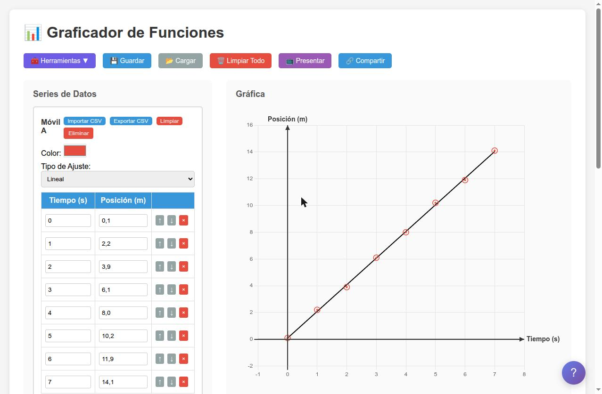

# 📊 Graficador Científico (Scientific Grapher)

🌐 **English** · [Español](README.md)

An interactive web app for analysing experimental data: regression fits, uncertainty propagation and unit-aware axis labels. Built for students, teachers, scientists and engineers.

**▶️ Try it now, nothing to install: [graficador.culturalibre.uy](https://graficador.culturalibre.uy)**




> **⚠️ Language note:** the app's interface (menus, help, messages) is currently **in Spanish only**. An ES/EN language selector is planned. This README is in English so the project is easier to find, evaluate and contribute to. The Spanish [README.md](README.md) is the reference documentation.

## ✨ Features

### 📈 Data analysis
- **Multiple data series** with customisable colours
- **6 fit types:**
  - Linear (y = ax + b)
  - Quadratic (y = ax² + bx + c)
  - Cubic (y = ax³ + bx² + cx + d)
  - Exponential (y = ae^(bx))
  - Logarithmic (y = a·ln(x) + b)
  - Power law (y = ax^b)
- **Automatic R²** and fit equations
- **Error bars** (Δx, Δy), entered **once per axis** ("column uncertainty"), not per row
- **Slope uncertainty** (max/min slope method; see *Methodological notes and limitations*)

### 🧮 Physics-oriented calculations
- **Uncertainty propagation:**
  - Sum (R = A + B)
  - Difference (R = A − B)
  - Product (P = A × B)
  - Quotient (C = A / B)
  - Educational significant-figure validation
- **Unit system:**
  - Catalogue of base and derived units plus SI prefixes (milli, kilo, …)
  - Axis labels in the form "Label (unit)"
  - Note: the app does **not** convert numeric data when you change units (a design decision); it only updates the labels
- **Calculations with units:**
  - Derivative shows the right units (e.g. m/s for velocity)
  - Integral shows the right units (e.g. m·s)
  - Significant figures applied automatically

### 🛠️ Interactive tools
- **Zoom and pan** with the mouse wheel and dragging
- **Tangent (derivative)** at any point with an interactive slider
- **Area under the curve (integral)** over a custom interval
- **Full customisation:** chart title, axis labels, axis limits, configurable grid
- **Export:**
  - PDF (chart and equations)
  - JPG (image)
  - CSV (tabular data)
  - Full project (.json)
- **Shareable links** (`?data=` URL) and a full-screen presentation mode

## 🚀 Quick start

### Option 1: Use the hosted version
Open [graficador.culturalibre.uy](https://graficador.culturalibre.uy) in any modern browser (Chrome, Firefox, Edge, Safari).

### Option 2: Run it locally

```bash
git clone https://github.com/kterva/graficador.git
cd graficador
python3 -m http.server 8000
```

Then open `http://localhost:8000`. You can also open `index.html` directly in your browser.

There is no build step and no framework: plain HTML, CSS and native ES modules.

## 📖 Basic workflow

The interface is in Spanish; the Spanish button names are given in quotes.

1. **Add data:** click **"+ Nueva Serie"** (new series) and type values into the table, paste from Excel / Google Sheets with `Ctrl + V` (tab, `;` or `,` separators are detected, and a header row is skipped), or use **"Importar CSV"** (two columns `X`, `Y`).
2. **Choose a fit:** pick the fit type in each series' dropdown. The equation and R² appear automatically.
3. **Set labels and units:** open **"⚙️ Configuración de Gráfica"** (chart settings). Units only change the axis labels; the numbers are not converted.
4. **Analyse:** show the tangent (derivative) with the slider, shade the area under the curve (integral) over an interval [x₁, x₂], or use **"🧰 Herramientas → 📐 Propagación de Errores"** (tools → error propagation).
5. **Export** as PDF, JPG, CSV, or save the whole project as `.json` to reload later.

### Example: kinematics, position vs. time

```
Data:
x (s): 0, 1, 2, 3, 4
y (m): 0, 5, 20, 45, 80

Setup:
- X axis: "Time (s)"
- Y axis: "Position (m)"
- Fit: quadratic

Results:
- Equation: y = 5.0x² + 0.0x + 0.0
- R² = 1.000
- Derivative at x = 2 s: 20.0 m/s (velocity)
```

### Example: error propagation

```
Operation: product
A = 10.5 ± 0.3
B = 2.0 ± 0.1

Result:
P = 21 ± 2
```

## 📐 Methodological notes and limitations

### Slope uncertainty (max/min method)
Estimated with the **extreme-points method**: take the points with the smallest and largest X, draw the steepest and the shallowest line that pass through their error boxes (`x ± Δx`, `y ± Δy` from the column uncertainty), and report `Δm = (m_max − m_min) / 2` (likewise for `Δb`).

Limitations:
- It uses only the **two extreme points**, not the whole data set.
- If the X error boxes of the extremes **overlap** (`x_n − Δx ≤ x_1 + Δx`), the method does not apply: the app does not report `Δm` and shows a warning.
- It needs at least one non-zero `Δx` or `Δy`.

### Non-linear regressions
`exponential`, `logarithmic` and `power` fits use **unweighted least squares on the linearised data** (`ln y`, `ln x`). This biases the fit towards smaller values. **R² is computed in the original data space**, so it is comparable with the polynomial fits.

### Dimensional analysis
The expression analyser (`🧰 Herramientas → Análisis Dimensional`) is **experimental**: it supports products, quotients and powers of quantities, but not sums/differences or parenthesis precedence.

## 🏗️ Architecture

Modular ES6, no bundler. The core maths (`calculations`, `regression`, `uncertainty-propagation`, `utils`, `units`, `dimensional-analysis`, `state`) is pure and tested in Node with `npm test`. See the "Arquitectura" section of the [Spanish README](README.md#️-arquitectura) for the full file map.

- **[Chart.js 3.9](https://www.chartjs.org/)** and its [zoom plugin](https://www.chartjs.org/chartjs-plugin-zoom/): chart, zoom and pan
- **[jsPDF](https://github.com/parallax/jsPDF)** and jsPDF-AutoTable: PDF export

Dependencies are served from `vendor/` (same origin, no third-party CDN) with Subresource Integrity; their licences are in `vendor/LICENSES.md`. A strict Content-Security-Policy in `index.html` fixes the allowed origins. The app has no ads and no tracking; the only external call is an anonymous visit counter.

## ⌨️ Keyboard shortcuts

| Shortcut | Action |
|----------|--------|
| `Ctrl + N` | New series |
| `Ctrl + S` | Save project |
| `Ctrl + E` | Export |
| `Enter` | Add row (in the table) |
| `Tab` | Move between cells |

## 🎓 Educational use

- **Physics:** uniform and accelerated motion, Hooke's law (F vs Δx), simple pendulum (T vs L), free fall
- **Chemistry:** reaction kinetics, Beer–Lambert law, titrations
- **Engineering:** experimental data analysis, sensor calibration, materials characterisation

## 🤝 Contributing

Contributions are welcome, and you can write issues and pull requests in English or Spanish.

1. Fork the repository
2. Create a branch: `git checkout -b feature/my-feature`
3. Commit: `git commit -am 'Add my feature'`
4. Push: `git push origin feature/my-feature`
5. Open a Pull Request

Particularly welcome: bug reports, documentation improvements, tests and **translations** (a language selector with an English interface is on the roadmap).

## 📄 License

Free software under the **GNU General Public License, version 3 or later** (GPL-3.0-or-later). See [LICENSE](LICENSE).

Copyright (C) 2025 Leonardo Trujillo. This program is free software: you can use, study, modify and share it; if you distribute modified versions, they must remain free under the same license. It comes with no warranty.

## 💛 Support the project

The Graficador is free software, free of charge, with no ads and no tracking. If it helps in your classes or lab, you can help it keep improving:

[](https://github.com/sponsors/kterva)

A ⭐ on the repository, a bug report, or telling another teacher it exists also helps a lot.

## 🙏 Acknowledgements

- [Chart.js](https://www.chartjs.org/) for charting
- [jsPDF](https://github.com/parallax/jsPDF) for PDF generation
- The open-source community

## 📧 Contact

- **Repository:** [github.com/kterva/graficador](https://github.com/kterva/graficador)
- **Issues:** [github.com/kterva/graficador/issues](https://github.com/kterva/graficador/issues)

---

**Made with ❤️ for the educational and scientific community**
